<p align="center">
  
</p>

<picture>
  <source media="(prefers-color-scheme: dark)" srcset="assets/header-dark.svg">
  <source media="(prefers-color-scheme: light)" srcset="assets/header-light.svg">
  
</picture>

<p align="center">
  <a href="https://github.com/lepotatoguy"></a>
  <a href="https://wakatime.com/@codeperfectplus"></a>
  <a href="https://lepotatoguy.github.io"></a>
  <a href="https://scholar.google.com/citations?user=lIwU1F0AAAAJ&amp;hl=en"></a>
  <a href="https://github.com/lepotatoguy"></a>
</p>

<picture>
  <source media="(prefers-color-scheme: dark)" srcset="assets/whoami-dark.svg">
  <source media="(prefers-color-scheme: light)" srcset="assets/whoami-light.svg">
  
</picture>

```python
class Joy(Human):
    """Efficient AI for deployment under limited compute."""

    languages  = ["Python", "Java", "PHP", "SQL", "JavaScript"]
    ai_stack   = ["PyTorch", "TensorFlow", "Keras", "OpenCV"]
    backend    = ["Django"]
    data_stack = ["NumPy", "Pandas", "Matplotlib", "Seaborn"]
    cloud      = ["AWS", "Docker", "Heroku", "VMware", "KVM"]

    domains    = ["Medical imaging", "Computer vision",
                  "Adversarial machine learning", "Cloud computing",
                  "Human-computer interaction"]
```

<picture>
  <source media="(prefers-color-scheme: dark)" srcset="assets/whoami-details-dark.svg">
  <source media="(prefers-color-scheme: light)" srcset="assets/whoami-details-light.svg">
  
</picture>

<picture>
  <source media="(prefers-color-scheme: dark)" srcset="assets/ecosystem-dark.svg">
  <source media="(prefers-color-scheme: light)" srcset="assets/ecosystem-light.svg">
  
</picture>

<picture>
  <source media="(prefers-color-scheme: dark)" srcset="assets/research-dark.svg">
  <source media="(prefers-color-scheme: light)" srcset="assets/research-light.svg">
  
</picture>

<table>
  <thead><tr><th align="left">Selected publication</th><th align="left">Venue / year</th></tr></thead>
  <tbody>
    <tr><td><a href="https://doi.org/10.1109/ICCVW69036.2025.00118">BAMPolyp: Bi-Axial Mamba Bottleneck for Gastrointestinal Polyp Segmentation</a></td><td>ICCV Workshops (CVAMD)<br>2025</td></tr>
    <tr><td><a href="https://doi.org/10.1038/s41598-025-87405-w">Tailoring adversarial attacks on deep neural networks for targeted class manipulation using DeepFool algorithm</a></td><td>Scientific Reports<br>2025</td></tr>
    <tr><td><a href="https://doi.org/10.1016/j.engappai.2024.109475">Involution fused convolution for classifying eye-tracking patterns of children with Autism Spectrum Disorder</a></td><td>Engineering Applications of Artificial Intelligence<br>2025</td></tr>
    <tr><td><a href="https://doi.org/10.1038/s41598-023-51015-1">Uncovering local aggregated air quality index with smartphone captured images leveraging efficient deep convolutional neural network</a></td><td>Scientific Reports<br>2024</td></tr>
    <tr><td><a href="https://doi.org/10.1109/ACCESS.2024.3401074">Sherlock in OSS: A Novel Approach of Content-Based Searching in Object Storage System</a></td><td>IEEE Access<br>2024</td></tr>
    <tr><td><a href="https://doi.org/10.1109/TCC.2022.3162790">Orchestrating Image Retrieval and Storage Over a Cloud System</a></td><td>IEEE Transactions on Cloud Computing<br>2023</td></tr>
    <tr><td><a href="https://doi.org/10.1145/3588001.3609361">&#x27;Khep&#x27;: Exploring Factors that Influence The Preference of Contractual Rides to Ride-Sharing Apps in Bangladesh</a></td><td>ACM COMPASS<br>2023</td></tr>
    <tr><td><a href="https://doi.org/10.1145/3530190.3534844">Note: Plant Leaf Disease Network (PLeaD-Net): Identifying Plant Leaf Diseases through Leveraging Limited-Resource Deep Convolutional Neural Network</a></td><td>ACM COMPASS<br>2022</td></tr>
  </tbody>
</table>

<p><a href="https://scholar.google.com/citations?user=lIwU1F0AAAAJ&amp;hl=en">Google Scholar</a></p>

<picture>
  <source media="(prefers-color-scheme: dark)" srcset="assets/telemetry-dark.svg">
  <source media="(prefers-color-scheme: light)" srcset="assets/telemetry-light.svg">
  
</picture>

<picture>
  <source media="(prefers-color-scheme: dark)" srcset="assets/activity-dark.svg">
  <source media="(prefers-color-scheme: light)" srcset="assets/activity-light.svg">
  
</picture>

<p align="center">
  <picture>
    <source media="(prefers-color-scheme: dark)" srcset="assets/languages-dark.svg">
    <source media="(prefers-color-scheme: light)" srcset="assets/languages-light.svg">
    
  </picture>
</p>
<p align="center"><sub>Language percentages reflect code volume in accessible, non-forked repositories.</sub></p>

<picture>
  <source media="(prefers-color-scheme: dark)" srcset="assets/footer-dark.svg">
  <source media="(prefers-color-scheme: light)" srcset="assets/footer-light.svg">
  
</picture>

<p align="center"><sub>Design adapted from <a href="https://github.com/Sakif16/Sakif16">Sakif16</a>.</sub></p>
